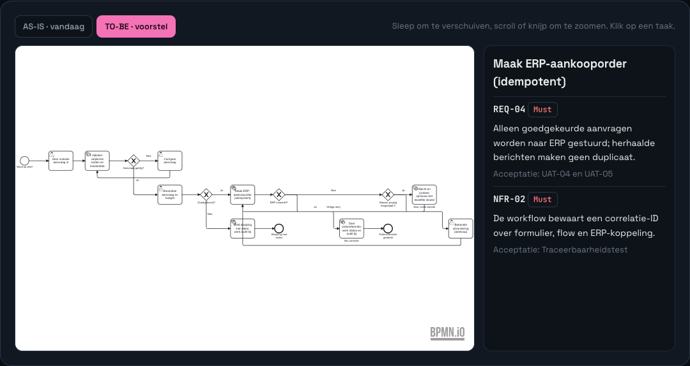

# Digital Transformation Analyst Portfolio

<!-- showcase:start -->
> **[▶ Bekijk de case-site](https://phlppgdfry.github.io/digital-transformation-analyst-portfolio/)** — het aankoopproces interactief in BPMN 2.0 (AS-IS en TO-BE), met per taak de requirements en UAT-tests die ze afdekt, plus links naar de werkende prototypes.

[](https://phlppgdfry.github.io/digital-transformation-analyst-portfolio/)
<!-- showcase:end -->

Een Nederlandstalig portfolio met uitgewerkte businessanalyses en werkende prototypes voor ERP, procesautomatisering, integraties en AI. Het is opgezet als sollicitatieportfolio voor rollen zoals Business Analyst, Functional Analyst en Digital Transformation Analyst.

> **Fictieve cases:** namen, processen, cijfers en voorbeelddata in de cases zijn verzonnen. De projecten demonstreren aanpak en technische prototypes; ze beweren geen implementatie bij Verhelst Group of een andere genoemde werkgever.

## Portfolio in één oogopslag

| Case | Businessvraag | Tastbaar bewijs |
|---|---|---|
| [01 — Aankoopproces voor een bouwgroep](cases/01-aankoopproces-bouwgroep/README.md) | Hoe verkorten we de doorlooptijd van werfaankopen en houden we grip op goedkeuringen? | AS-IS/TO-BE, BPMN 2.0, requirements, user stories, integratieontwerp, UAT, KPI's en businesscase |
| [02 — AI-assistent voor werfdocumenten](cases/02-ai-werfdocumenten/README.md) | Hoe vinden medewerkers snel een betrouwbaar antwoord in gecontroleerde werf- en veiligheidsdocumenten? | Scope, architectuur, bronvermelding, toegangscontrole, risico's, human oversight en meetplan |
| [03 — ERP-integratie en uitzonderingen](projects/erp-integration-operations/README.md) | Hoe verwerken we webshoporders betrouwbaar over ERP en magazijn, met zicht op fouten? | Werkende TypeScript-service, mock-WMS, Business Central-extensie, exception dashboard en Power Platform-blauwdruk |
| [04 — AI-ondersteunde ERP-orderinvoer](projects/ai-assisted-erp-operations/README.md) | Hoe zetten we vrije klantvragen om in een voorstel dat een medewerker controleert vóór ERP-mutatie? | .NET API en dashboard, expliciete goedkeuring, auditspoor en demo-adapter |
| [05 — Enterprise-integratie](projects/enterprise-integration/README.md) | Hoe verwerken we partnerberichten met validatie en foutafhandeling? | Java REST-service, SQL-schema, Docker en voorbeeldberichten |
| [06 — Knowledge assistant lab](projects/knowledge-assistant-lab/README.md) | Hoe bouwen en evalueren we een assistent die antwoorden aan bronnen bindt? | Python-labs rond grounding, structured output en evaluatie |

## Zo gebruik je dit portfolio

Begin met de aankoopcase om de analyse van probleem tot acceptatietest te volgen. Gebruik daarna de AI-case voor verantwoord AI-ontwerp. De technische projecten tonen vervolgens hoe requirements kunnen doorwerken tot een prototype en operationeel beheer.

```text
businessprobleem → proces → requirements → oplossing → integratie → testen → adoptie → meten
```

Elk project heeft een eigen README met benodigdheden en startinstructies. De prototypes gebruiken waar mogelijk mocks en fictieve gegevens; echte ERP- of AI-diensten zijn optioneel.

## Leerroute

Een praktisch leerpad van vier blokken staat in [LEERPAD.md](LEERPAD.md). Het combineert BPMN en requirements, ERP en integraties, Power Platform en AI, en projectdelivery met UAT en adoptie. Certificaties zoals PL-900 zijn leerdoelen, geen claim dat ze al behaald zijn.

## Grenzen en juist gebruik

- Dit is een onafhankelijk portfolio. Er is geen relatie of goedkeuring van Verhelst Group.
- Geen klantgegevens, toegangsgegevens of productieconfiguraties opnemen.
- KPI's en baten in de aankoopcase zijn **hypotheses voor een fictieve pilot**. Een echte businesscase moet met een nulmeting en proceseigenaars gevalideerd worden.
- De AI-assistent adviseert en citeert bronnen; veiligheidskritische beslissingen blijven bij bevoegde medewerkers.
- Zie de licentie in ieder project. De oorspronkelijke projecten kunnen verschillende licenties hebben.

## Structuur

```text
cases/       businessanalyse-cases en analyst artefacten
projects/    zelfstandige prototypes en labs met hun eigen documentatie
LEERPAD.md   gefaseerd persoonlijk leerplan
```

